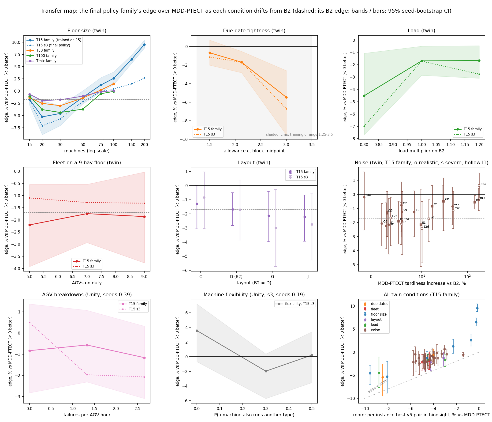

# rq3-transfer-map: one edge-retention measure across every measured drift (2026-10-25, user: remaining work plan §2a)

Status: **done 10-25 (analysis only, no new runs; `analyze.py`, ~20 s).** Outputs: `analysis.out` (all tables),
`transfer_map.csv` (one row per condition × policy), `transfer_map.png` (the figure).

## Question
How far from its training configuration does the final policy's edge last, measured the same way on every kind of
drift? The user (10-23) wants a policy that transfers, and a measure of how much edge it loses the further a floor
moves from training. This is the RQ3 answer the plan asks for: one figure and one table.

## Definitions
- **Policy:** the final-policy family, train-v5-cmix s0-s4, trained on B2 (15 machines, 7 AGVs, layout D, c ~
  U[1.25, 3.5]). The family is the per-instance mean of its 5 seeds, as in every source. s3 (the final policy) is
  also reported.
- **Edge:** % window tardiness vs MDD-PTECT held all episode, pooled over test seeds (< 0 better), with a 95%
  seed-bootstrap CI.
- **Retention:** edge at the condition / the family's twin edge on B2 (−1.69% [−2.86, −0.52], seeds 0-39). It uses a
  paired seed bootstrap. Twin axes only: in Unity the B2 edge is not below 0 (s3 +0.5% on seeds 0-39, +3.6% on 0-19),
  so a Unity ratio has no meaning.
- **Gap:** family vs the condition's best v5 pair, chosen in-sample.
- **Room:** the per-instance best of the 6 v5 pairs in hindsight, pooled, vs MDD-PTECT: how much a rule choice can
  gain on that condition without switching. **Capture** = edge / room.
- **Landscape shift:** how far the condition moves the 6 pairs' ranking from B2's, (1 − Kendall τ) / 2, plus the mean
  absolute change of their % in points.

## Sources (read through each experiment's own loaders; every headline reproduces)
| axis | conditions | sim, seeds | source |
|---|---|---|---|
| floor size | 15, 20, 30, 50, 75, 100, 150, 200 machines; arms T50 / T100 / Tmix on 15-100 | twin, 0-39 | `../rq3-size-grid`, `../rq3-size-v5` |
| due dates | c 1.25-1.75 / 1.75-2.5 (B2) / 2.5-3.5 | twin, 0-39 | `../eval-v5-cmix/test`, `../rq3-gen-v5` |
| load | × 0.8 / 1.0 / 1.2 | twin, 0-39 | `../rq3-gen-v5-cmix`, `../rq3-gen-v5` |
| fleet | 5 / 7 / 9 AGVs on a 9-bay floor | twin, 0-39 | same |
| layout | C / D (B2) / G / J | twin, 0-39 | same |
| noise | 24 cells (E1-O3, mix; realistic / severe; I1); x = MDD-PTECT's degradation vs B2 | twin, 0-39 | `../rq4-uncert-v5-policy` (E3 / mix on the screen's measure, as there) |
| AGV breakdowns | none, Weibull λ 3000 / 1500 s (1.33 / 2.66 failures per AGV-hour) | Unity, 0-39 | `../rq4-agvfail-v5-cmix`, `../rq4-agvfail-v5-rules` |
| flexibility | p 0 / 0.3 / 0.5 | Unity, 0-19, s3 only | `../rq3-flex-v5-unity` |
| Unity subset | B2, load × 1.2, tight c, layout G | Unity and twin, 0-19, s3 only | `../rq3-gen-v5-unity-cmix` |

## Results

### By axis (T15 family, twin; `analysis.out` has every condition, s3, CIs and the arms)
| axis | condition | edge [95% CI] | retention [95% CI] | room | capture |
|---|---|---|---|---|---|
| B2 | 15 machines, c 1.75-2.5, ×1.0, 7 AGVs, D | **−1.69** [−2.86, −0.52] | 1 | −4.51 | 0.37 |
| floor size | 20 / 30 | **−5.28** / **−4.59** | 3.1 [1.3, 9.6] / 2.7 [1.3, 9.4] | −8.1 / −9.6 | 0.66 / 0.48 |
| | 50 | −1.29 [−2.59, +0.07] | 0.76 [−0.03, 2.4] | −4.6 | 0.28 |
| | 75 | +1.24 [−0.24, +2.76] | −0.73 | −2.3 | < 0 |
| | 100 / 150 / 200 | **+2.60** / **+6.51** / **+9.54** | −1.5 / −3.9 / −5.6 | −0.7 / −0.3 / −0.2 | < 0 |
| due dates | c 1.25-1.75 / 2.5-3.5 | −0.67 [−2.01, +0.70] / **−5.47** | 0.40 / 3.2 [1.5, 10.5] | −4.0 / −8.5 | 0.17 / 0.65 |
| load | × 0.8 / × 1.2 | **−4.52** / **−1.67** | 2.7 [0.7, 7.4] / 0.98 [0.26, 3.9] | −8.8 / −3.0 | 0.52 / 0.55 |
| fleet (9 bays) | 5 / 7 / 9 AGVs | **−2.21** / **−1.75** / **−1.87** | 1.31 / 1.03 / 1.10 | −5.0 / −4.5 / −4.4 | 0.44 / 0.39 / 0.43 |
| layout | C / G / J | −1.28 / **−2.14** / **−2.22** | 0.76 / 1.27 / 1.31 | −3.1 / −4.7 / −4.2 | 0.41 / 0.46 / 0.52 |
| noise, processing time | E1, E2, E2d, O3 (realistic / severe) | −1.3 to −2.3 (3 of 8 significant) | 0.74-1.33 | −3.6 to −5.8 | 0.24-0.47 |
| noise, information / arrivals | O1, O2, E3, E4n, mix (realistic / severe) | −1.9 to −0.2 (2 of 10 significant) | 0.11-1.14 | −1.4 to −5.6 | 0.05-0.40 |
| noise, with I1 | E2, E2d, mix | −2.43 to +0.63 (4 of 6 significant) | −0.37 to 1.44 | −3.0 to −5.2 | −0.21 to 0.46 |

**Unity axes** (edge only; s3 in brackets):
- AGV breakdowns, none / λ 3000 / λ 1500: family −0.83 / −0.57 / −1.17 (all n.s.); s3 +0.50 / −1.97 / **−2.08**.
- Flexibility (s3, 20 seeds), p 0 / 0.3 / 0.5: +3.56 / −1.98 / +0.20 (all n.s.).
- Unity subset (s3, 20 seeds), load × 1.2 / tight c / layout G: **−4.13** / **−2.76** / **−2.87** in Unity, against
  −1.77 / −0.52 / −3.17 (n.s.) in the twin on the same seeds. The Unity B2 base on those seeds is +3.56 (n.s.).

### The unifying measure: room, not distance
- **The edge tracks the room a condition leaves.** Over all 42 twin conditions (B2 excluded), edge vs room has
  Spearman ρ +0.78 (p 1e-9). Without the floor-size axis it is +0.66 (p 2e-5, 34 conditions); on floor size alone,
  +0.95.
- **Capture is roughly constant.** On the 37 conditions with room beyond −2.5%, the family captures a median 0.38 of
  it (IQR 0.24-0.45, range −0.21 to 0.66); B2 itself is 0.37. Retention above 1 is therefore no surprise: the
  conditions where the edge grows are the ones with more room (20-30 machines, loose due dates, light load: room −8
  to −10%).
- **Distance from training does not predict the edge.** The landscape shift (1 − τ) / 2 has ρ +0.19 (p 0.23).
  Loose due dates, light load and 20-30 machines reorder the pairs as much as 150-200 machines do (shift 0.3-0.7 vs
  0.2), yet the policy gains on the first group and loses on the second.
- **Where the edge is lost:**
  - **Large floors (≥ 75 machines):** the room shrinks to −2.3 / −0.7 / −0.3 / −0.2%. MDD-PTECT is near the
    per-instance best there, so every non-MDD-PTECT choice costs, and the 15-machine policy keeps making those
    choices (capture < 0). The T100 arm, trained there, captures 0.11-0.81 on 15-100 machines and is never worse than
    MDD-PTECT.
  - **Some noise cells keep most of the room but lose capture.** Severe booking delays, sensor dropouts, realistic
    arrival lateness, the mix and realistic rush orders capture only 0.05-0.20 (O1 severe 0.18, O2 0.19 / 0.09, E3
    realistic 0.17, mix 0.20 / 0.12, E4n realistic 0.05). Processing-time noise (E1, E2, E2d, O3) captures
    0.24-0.47. These corrupt what the policy observes or when jobs arrive, not how long operations take. The pattern
    has exceptions (E3 severe 0.40, E4n severe 0.39) and every cell's CI is wide.
  - **Tight due dates** (c 1.25-1.75, inside the training c range) capture only 0.17.

### Reading for the thesis (RQ3)
- **The edge does not decay with distance from training.** It scales with how much the rule choice matters on the new
  floor. Within B2-like floors (fleet 5-9, layouts C / G / J, load × 1.2, processing-time noise) the family keeps
  its edge (retention 0.74-1.33, 20 of 42 twin conditions significantly better than MDD-PTECT).
- **It gains where the room grows:** 20-30 machines, loose due dates, light load.
- **It fails in two ways:**
  - on floors much larger than training, where the room vanishes and its rule preferences cost (fix: train at the
    largest size, `../rq3-size-grid` arms; or a travel-aware action, `../rq3-size-headroom`);
  - under noise that corrupts its inputs or the arrival stream, where the room is there but it captures little.
- **One measure for every axis:** capture = edge / room. The final policy captures about a third of the room on its
  training floor (0.37), and about the same on most drifted floors.
- **Unity:** the axes there are noisier (s3 only and 20 seeds for flexibility and the subset). s3's edge is negative
  on 6 of the 7 drifted Unity conditions, 4 of them significantly (breakdowns λ 1500, load × 1.2, tight c, layout G).
  But the Unity B2 reference itself is not significant, so these conditions cannot carry a retention figure.

## Caveats
- **Room is in-sample hindsight per instance and shares the MDD-PTECT denominator with the edge.** Part of the
  correlation is that normalization: a condition where MDD-PTECT is relatively poor raises both. The substantive
  claim is the steady capture, and the policy sees no hindsight.
- **Retention CIs are wide** (roughly ±1 around the point) because B2's edge is only 1.69 [0.52, 2.86] points.
  Capture has the same weakness. Read both as point estimates across conditions, not per-condition tests.
- **The due-date conditions lie inside cmix's training c range** (1.25-3.5), so the due-date axis is in-distribution
  drift.
- **Floor sizes above 15** also change load (B2 × 0.9) and the fleet ratio (0.52 per machine; B2 0.47), as in the
  grid.
- **Pooled-condition statistics** (ρ, counts of significant conditions) treat conditions as independent. Several
  share B2's instances: noise cells are the B2 instances with noise added, and layouts and fleets reuse its seeds.
- **The noise-category split** (processing-time vs information / arrivals) was drawn after looking at the numbers. It
  is a reading, not a pre-declared test.
